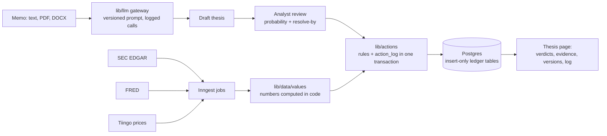

# Veritas

A system of record for investment reasoning, for discretionary and fundamental investment teams.

[](https://github.com/AdityaShekhawat0504/veritas/actions/workflows/ci.yml)

## Why it matters

Investment memos state a view, but the assumptions behind it are rarely written down in a form that can be checked later. When a thesis breaks, teams find out from the price, not from the data that broke it, and nobody can say afterwards how good the original forecasts were. Veritas turns each thesis into assumptions with a probability and a resolution date, checks them against filings and macro data, and keeps a permanent log of every change and decision.

## How it works

1. **Intake.** An analyst pastes a memo or uploads a PDF/DOCX. The LLM gateway drafts the claim, falsifiable assumptions, resolution dates, indicators and kill criteria. Indicators can only come from a closed catalog; anything else is dropped.
2. **Review.** The analyst edits every assumption. Critical assumptions cannot be saved without the analyst's own probability and a resolve-by date. Saving freezes version 1 of the thesis.
3. **Numeric checks.** Background jobs pull SEC EDGAR XBRL facts, FRED series and end-of-day prices. Code computes the value (y/y growth, margins, drawdowns) and compares it to the indicator threshold. No model is involved in a numeric verdict.
4. **Alerts.** A check is always stored; an alert is raised only when the verdict changes. Kill criteria fire once when their indicator condition is met.
5. **Ledger.** Every write goes through a named action that validates its rules and appends to `action_log` in the same transaction. `action_log`, `checks`, `thesis_versions` and `evidence` are insert-only, enforced by database triggers.



Verdicts are `supported`, `weakened`, `contradicted` or `insufficient_evidence`. A numeric indicator has a threshold and an optional break threshold: meeting the threshold is supported, missing it but staying past the break threshold is weakened, anything else is contradicted, and missing data is insufficient evidence. Text checks (planned) must quote the stored source word for word; the verbatim-quote rule is already enforced in `runCheck`, so an unverified quote is recorded as `insufficient_evidence`.

More detail: [docs/ARCHITECTURE.md](docs/ARCHITECTURE.md).

## Results

There are no evaluation numbers yet. The gold set in `eval/gold/gold.jsonl` is empty, so `pnpm eval` prints `n/a` for precision, false-alert rate and abstention rate. `pnpm eval --examples` runs on three illustrative entries and prints them under an "EXAMPLE DATA" banner; those numbers are not results.

Not yet measured: precision of `contradicted` on real filings, false-alert rate on clean controls, and cost per check. They will be reported here once the gold set holds real historical assumptions.

## Quickstart

Requires Node 22 and pnpm 10.

```bash
pnpm install
pnpm test        # unit and database tests on in-memory Postgres (PGlite), no secrets needed
pnpm eval        # gold-set evaluation (empty set prints n/a)
```

To run the app you need a Postgres database with pgvector and Google OAuth credentials:

```bash
cp .env.example .env.local     # fill in DATABASE_URL, AUTH_* and the data source keys
pnpm db:migrate                # apply db/migrations
pnpm db:seed-catalog           # load the indicator catalog
pnpm dev                       # http://localhost:3000
```

Set `LLM_PROVIDER=mock` to click through intake without an OpenAI key. Everything needed for a live deployment is listed in [docs/GO_LIVE.md](docs/GO_LIVE.md).

## Tech stack

Next.js 15 (App Router, TypeScript), Tailwind CSS 4, Drizzle ORM, Postgres (Neon, EU region) with pgvector, Auth.js v5 (Google), Inngest for background jobs, OpenAI structured outputs behind a provider-neutral gateway, Vitest with PGlite for tests, Vercel.

Data: SEC EDGAR (free), FRED (free API key), Tiingo end-of-day prices (paid plan for commercial use). US-listed companies only for now.

## Project structure

```
app/                  Pages (dashboard, intake, review, thesis) and API routes
components/           UI components
db/                   Drizzle schema, enums, SQL migrations, migration runner
lib/actions/          The only write path: one function per action, rules in rules.ts
lib/llm/              LLM gateway, providers (OpenAI, mock), versioned prompts
lib/data/             EDGAR, FRED and Tiingo adapters, rate limiter, catalog, value maths
lib/jobs/             Ingestion and numeric-check jobs (plain functions)
lib/inngest/          Inngest client and function wiring
lib/intake/           Memo text extraction, draft creation, review-screen logic
eval/                 Gold-set format, metrics and the pnpm eval runner
seed/                 Demo thesis format with three EXAMPLE entries
tests/                Vitest suites and fixtures
docs/                 Architecture and go-live checklist
```

## Status by phase

| Phase | Scope | Status |
|---|---|---|
| 0 | Schema, action layer with rules and action_log, insert-only tables, eval skeleton | Built, tests written |
| 1 | Memo intake, LLM extraction, review screen | Built, tests written |
| 2 | EDGAR, FRED and Tiingo adapters, indicator catalog, numeric checks, Inngest jobs | Built, tests written; not yet run against live APIs |
| 3 | Cited text checks over filing text (pgvector), eval metrics for text checks | Not started |
| 4 | PM board, integrity score, email alerts | Not started |
| 5 | Audit export, revise UI, firm roles and invites, Microsoft Entra sign-in | Not started (roles exist in the schema) |
| 6 | Demo seed and calibration view | Format only (`seed/`) |

v1 (the earlier memo-scoring app) is live from `main`. v2 lives on the `v2` branch and is not deployed yet.

## Limitations and next steps

- The test suite and the build have not been run in a full environment yet; CI on this branch is their first full run.
- Adapter tests use synthetic fixtures in the documented response shapes, not recorded live responses. The first live check is a manual step in docs/GO_LIVE.md.
- Quarterly XBRL indicators use three-month facts. Many companies do not report a three-month Q4, so after a 10-K the latest quarterly value is still Q3.
- Price returns use Tiingo adjusted closes from the position's entry date, so they include dividends.
- Rate limits are per process. Inngest functions run with concurrency 1 to keep the total under the EDGAR and FRED limits.
- Next: build the gold set, then Phase 3 (cited text checks with double-run agreement and the full eval report).
