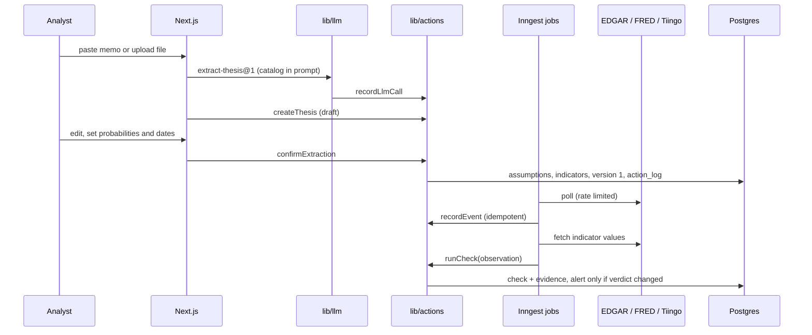

# Architecture

## Components

| Component | Where | Job |
|---|---|---|
| Schema | `db/schema.ts`, `db/migrations/*.sql` | Drizzle tables for the app; SQL migrations hold the constraints and triggers. `tests/schema.test.ts` fails if the two drift apart. |
| Action layer | `lib/actions/` | The only code that writes. One function per action; each parses its input, checks roles and rules, writes, and appends to `action_log` in the same transaction. |
| Rules | `lib/actions/rules.ts` | Pure functions: forecast requirements, numeric verdicts, quote verification, alert-on-change, decisions, Brier score. |
| LLM gateway | `lib/llm/` | `callStructured` is the only way to call a model. Logs provider, model, prompt id and version, tokens, cost and latency for every call, including failures. Prompts live in `lib/llm/prompts/` with a version string. |
| Data adapters | `lib/data/` | EDGAR, FRED and Tiingo clients, a sliding-window rate limiter, the indicator catalog, and the value maths. |
| Jobs | `lib/jobs/`, `lib/inngest/` | Ingestion (filings, macro releases, prices) and numeric checks as plain functions; Inngest wires them to crons and events. |
| Intake | `lib/intake/`, `app/thesis/new`, `app/thesis/[id]/review` | Memo text extraction, draft creation, and the review-screen logic. |
| Reads | `lib/queries.ts` | Read-only queries for pages, scoped to the viewer's firm. |
| Eval | `eval/` | Gold-set format (JSONL), metrics and the runner behind `pnpm eval`. |

## Data flow

## Key design decisions

**One write path.** Pages and API routes call `lib/actions`. Each action runs in one transaction with its `action_log` row, so a failed rule leaves no partial write and no orphan log entry. This gives the audit trail, the decision journal and the forecast history from the same mechanism.

**Rules enforced twice.** The action layer rejects bad input with a clear message, and the database enforces the same rules as constraints, so a bug or a manual SQL session cannot bypass them:

- `critical_needs_forecast`: a critical assumption without probability and resolve-by date cannot be inserted.
- `numeric_has_no_model`: a numeric check row cannot name a model or prompt version.
- `checks_need_evidence`: a deferred constraint trigger rejects, at commit, any check with a real verdict and no evidence row.
- Insert-only triggers on `action_log`, `checks`, `thesis_versions`, `evidence` and `llm_calls` reject UPDATE, DELETE and TRUNCATE.
- Alerts must record a real change (`previous_verdict IS DISTINCT FROM new_verdict`).

**The model proposes, code decides.** For numeric indicators the model only suggests catalog keys and thresholds during intake; the analyst confirms them and the verdict is computed in `numericVerdict`. For text checks, `runCheck` keeps a model's verdict only if its quote appears in the stored document after whitespace and typographic-quote normalisation; otherwise the verdict is `insufficient_evidence`.

**Closed indicator catalog.** Indicators reference `indicator_catalog` by foreign key. Catalog keys are never edited; a changed definition gets a new key, so past checks keep their meaning.

**Overrides are new rows.** `overrideVerdict` (PM or admin only) inserts a new check that points to the one it overrides. The original stays.

**Versions are snapshots.** Confirming, revising and closing a thesis each freeze the full state (assumptions, indicators, kill criteria, position) as JSON in `thesis_versions`. Revisions need a reason.

**Forecast captured at resolution.** `resolveAssumption` stores the probability in force with the outcome, so Brier scores can be computed later without reconstructing history.

**Sign-in without an adapter.** Auth.js uses JWT sessions. The first sign-in calls `ensureUser`, which creates the user, a personal firm and an admin membership through the action layer.

**Hand-written SQL migrations.** Constraints, triggers and the pgvector extension are easier to read and review as SQL. `db/migrate.ts` applies files in order and records them in `schema_migrations`.

**Tests on real Postgres.** PGlite runs Postgres in WebAssembly, so the action tests exercise the real constraints, triggers and transactions without a server or secrets.

**Rate limits per process plus concurrency 1.** The limiter keeps each process at 8 EDGAR requests per second and 100 FRED requests per minute; each Inngest function runs one at a time so serverless instances do not multiply the rate.
